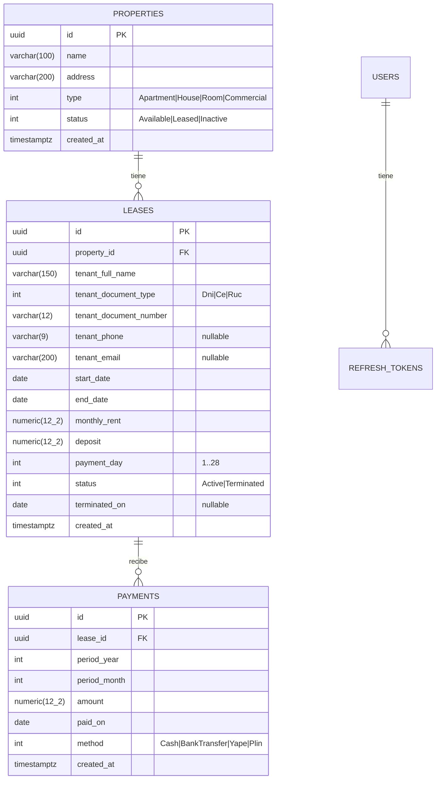

# 01 · Modelo de datos

PostgreSQL 18, esquema `public`, nombres en `snake_case` (convención de la plantilla). Las relaciones son por FK sin propiedades de navegación (convención VSA del repo).

## Decisiones del modelo

| Decisión | Motivo |
|---|---|
| El arrendatario va **embebido en `leases`** (columnas `tenant_*`). | En v1 nadie consulta "todos los contratos de una persona". Evita una tabla y su CRUD. Separarlo luego es una migración simple. |
| Las fechas del contrato y del pago son **`date`** (`DateOnly`), no `timestamptz`. | Son fechas de calendario de negocio en Lima, no instantes. Así se evitan los corrimientos por zona horaria (RN-18). |
| El período se guarda como **`period_year` + `period_month`**. | Permite indexar y agrupar sin parsear texto. En la API se expone como `"YYYY-MM"`. |
| El **estado de cuenta no se persiste**: se calcula a partir de `leases` + `payments` + "hoy". | Nunca queda desactualizado y no necesita jobs. Ver ADR-004. |
| Montos en `numeric(12,2)` (`decimal`). | RNF-05: nunca `double` para dinero. |
| `properties.status` se guarda (no se deriva). | Lo cambian casos de uso explícitos (RN-10, RN-11, CU-04) y el resumen lo lee sin joins. |

## Índices

| Tabla | Índice | Uso |
|---|---|---|
| `leases` | `(property_id, status)` | Chequeo de solapamiento (RN-05) y resumen (RF-07). |
| `payments` | `(lease_id, period_year, period_month)` | Suma por período (RN-14) y estado de cuenta (RF-05). |
